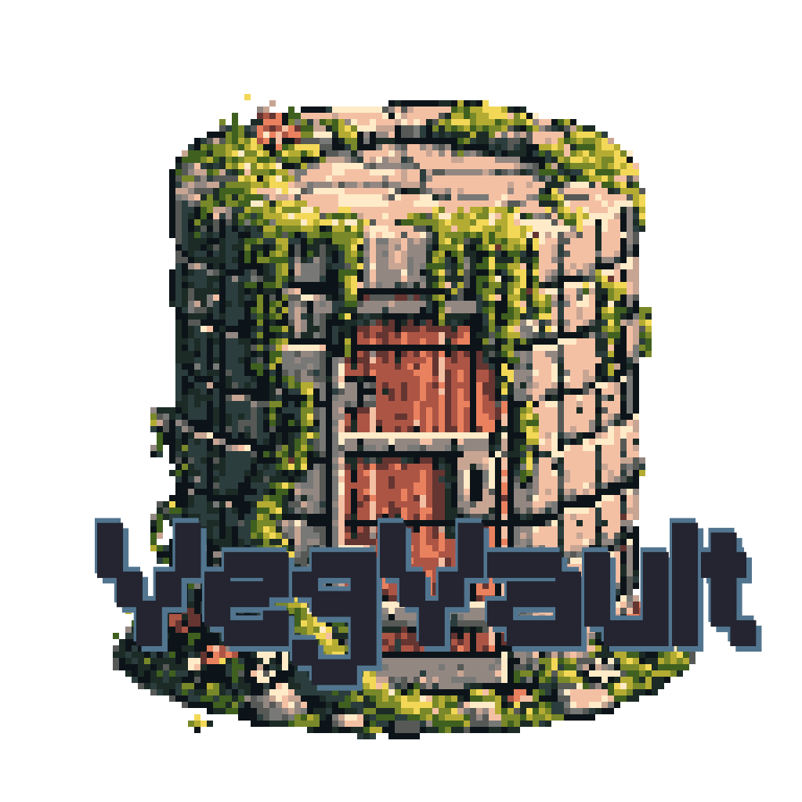

---
format:
  gfm:
    # The line breaks of this file, no wrapping, and no ".png" added to
    #   image links without an extension (pandoc's default), which broke
    #   the badge URL
    wrap: preserve
    default-image-extension: ""
---

<!-- README.md is generated from README.qmd. Please edit that file -->

# VegVault database 

<!-- badges: start -->

<!-- badges: end -->

The goal of this repo is to create an SQLite database with all data from [BIODYNAMICS project](https://ondrejmottl.github.io/projects/BIODYNAMICS/).

Please visit [VegVault website](https://bit.ly/VegVault) for more details.
