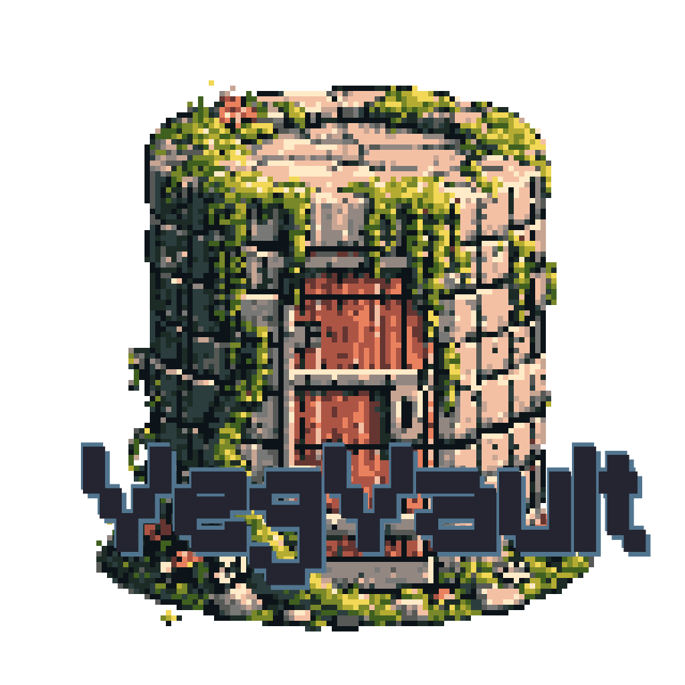

# VegVault

## Database linking global paleo-, and neo-vegetation data, functional traits, and climate

This is the official website dedicated to the [VegVault]{.vegvault} project. [VegVault]{.vegvault} is a comprehensive [SQLite database]{.database} that integrates global [paleo-]{.paleo} and [neo-ecological vegetation data]{.neo-vegetation} with [functional traits]{.traits} and [abiotic information]{.abiotic}, including [climate]{.abiotic} and soil data. By bridging historical and contemporary data across multiple temporal and spatial scales, [VegVault]{.vegvault} provides a unique resource for examining long-term ecological patterns and processes, thereby enhancing our ability to predict future biodiversity trajectories and ecosystem responses under changing climatic conditions.

The project integrates data from multiple well-established sources including the [Neotoma Paleoecology Database](https://www.neotomadb.org/), [sPlotOpen](https://idiv-biodiversity.de/en/splot/splotopen.html), [BIEN](https://bien.nceas.ucsb.edu/bien/), [TRY Plant Trait Database](https://www.try-db.org/TryWeb/Home.php), [CHELSA climate data](https://chelsa-climate.org/), and the [Harmonized World Soil Database](https://data.apps.fao.org/catalog/iso/ff5c613c-75bb-46a9-a162-bc728059b465) to provide a comprehensive view of vegetation dynamics across space and time.

Creating such an [integrated database]{.database}, in which gathering and processing of the data is [reproducible]{.reproducibility}, is a crucial step toward improving our understanding of biodiversity dynamics under changing climatic conditions and safeguarding biodiversity in an uncertain future.

The project is part of the [BIODYNAMICS](https://bit.ly/BIODYNAMICS) project.

## Quick Navigation

- **[Access the Database](/website/database_access.qmd)** - Download [VegVault]{.vegvault} and get started
- **[Database Structure](/website/database_structure.qmd)** - Understand the data organization
- **[Usage Examples](/website/database_examples.qmd)** - See practical applications
- **[Database Content](/website/database_content.qmd)** - Explore what's included
- **[Get Involved](/website/contribute.qmd)** - Contribute to the project

[Access Database](/website/database_access.qmd){.btn} [Database paper](https://doi.org/10.1038/s41597-025-06176-1){.btn}